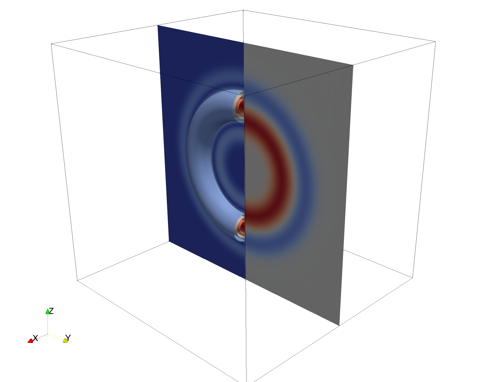
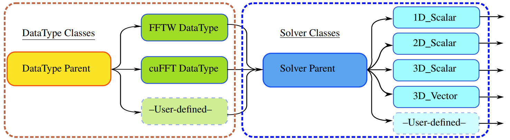

# SailFFish - A lightweight fast Poisson solver for execution on both CPU & GPU.

The purpose of SailFFish is to provide an open source, easily linked fast Poisson solver with minimal
dependencies. The software is configured for shared memory machines.
At the heart of the solver is the fast Fourier transform (FFT), which allows us to integrate the Poisson equation in frequency space.
Transforms to and from the frequency space via FFTs are not carried out by SailFFish,
but rather call existing (and very optimised) libraries through the inherited `DataType` class.
Currently three backends exist:
* [FFTW](https://www.fftw.org/), the (deservedly) popular library for multithreaded calculation on a CPU;
* [cuFFT](https://docs.nvidia.com/cuda/cufft/index.html), for calculation on NVIDIA GPUs;
* [VkFFT](https://github.com/DTolm/VkFFT), a high-performance multi-API GPU FFT library, used here through its OpenCL backend for calculation on numerous GPU platforms.

Solvers exist for 1D, 2D and 3D scalar and 3D vector input fields. A range of differential operators may be applied to modify the form of the Poisson equation being solved.
SailFFish additionally contains a vortex particle-mesh (VPM) solver built on the 3D vector solvers.

<p align="center">

</p>
A 3D vector solver with a curl differential operator has been used to solve for the velocity distribution (right half: x-velocity field) of a vortex ring (left half: vorticity contours).
<br />

## Why should you use SailFFish?
* You want a relatively simple library for the calculation of the Poisson equation on a regular grid;
* You are not carrying out calculations with a distributed memory architecture;
* You want to use the GPU to optimise your calculations;
* You want to compile a lightweight executable for a specific form of the fast Poisson equation;
* You want an easy library or namespace which you can link to in your own software.

## What does SailFFish do?
SailFFish solves the Poisson equation
```math
\nabla^2\psi = f
```
where the right-hand side $f$ is defined on a rectangular grid with regular grid spacing.
The input/solution vector can be specified for either *regular* (cell boundary) or *staggered* (cell centre) grid configurations and can be defined as either
scalar data or 3-vector data.

### Which boundary conditions are available?
The solver can be executed as a *bounded* solver, whereby the boundary conditions (BC) are specified.
In this case three types of solver are available:
* Periodic BC
* Dirichlet (odd-symmetric extension, sine transforms) or Neumann (even-symmetric extension, cosine transforms) BC
	* Homogeneous BC: Two options exist for the eigenvalues: pseudo-spectral (`SailFFish::PS`) or finite-difference second-order (`SailFFish::FD2`)
	* Inhomogeneous BC: arbitrary BCs may be specified, however only with use of the `SailFFish::FD2` type eigenvalues.

Alternatively an *unbounded* solver may be applied, whereby the BCs need not be specified and the potential is treated as if the problem were unbounded.
In this case a range of options exist for the calculation of the free-space Green's function.

### Known backend limitations
Not every solver is available with every backend:
* **cuFFT** does not provide real-to-real transforms (DCT/DST). The bounded Dirichlet and Neumann solvers are therefore not available with the cuFFT backend; their setup returns `SetupError`.
* **VkFFT**: inhomogeneous boundary conditions (`Set_BC`) are not yet applied, and the 1D unbounded solver is not yet implemented.

The FFTW backend supports all solvers.

## Compilation
SailFFish is configured with CMake (version 3.23 or newer). It has been tested with GCC 11.2 (MinGW-w64) on Windows.

### Dependencies
All builds require:
* [Eigen](https://eigen.tuxfamily.org) (linear algebra library)
* OpenMP

Depending on the chosen backend, additional dependencies are required:

| Backend | Dependency | CMake variables (Windows) |
|---|---|---|
| `FFTW` | [FFTW3](https://www.fftw.org/download.html) | `FFTW_DIR`: folder containing `fftw3.h`, `libfftw3-3.lib` and `libfftw3f-3.lib` |
| `CUFFT` | [NVIDIA CUDA toolkit](https://developer.nvidia.com/cuda-toolkit) | `CUDA_DIR`: CUDA toolkit root, e.g. `C:/Program Files/NVIDIA GPU Computing Toolkit/CUDA/v12.6` |
| `VKFFT` | [VkFFT](https://github.com/DTolm/VkFFT) source, OpenCL headers and loader | `VKFFT_DIR`: VkFFT source folder<br>`OPENCL_HEADERS`: folder containing `CL/cl.h`<br>`OPENCL_LIB`: folder containing the OpenCL import library |

The OpenCL headers can be taken from the [Khronos OpenCL-Headers](https://github.com/KhronosGroup/OpenCL-Headers) repository.
On Linux, FFTW and OpenCL are taken from the system libraries.
If a required path is not set or does not contain the expected files, CMake stops with a message naming the missing variable.

### Build options
The following CMake cache variables control the build:

| Variable | Values | Default | Description |
|---|---|---|---|
| `SAILFFISH_BACKEND` | `FFTW`, `CUFFT`, `VKFFT` | `FFTW` | FFT backend |
| `SAILFFISH_PRECISION` | `Single`, `Double` | `Single` | Floating point precision |
| `SAILFFISH_BUILD_VPM` | `ON`, `OFF` | `OFF` | Build the vortex particle-mesh solver |
| `SAILFFISH_BUILD_TESTS` | `ON`, `OFF` | `OFF` | Build the test executable (requires GoogleTest) |
| `SAILFFISH_NATIVE_ARCH` | `ON`, `OFF` | `ON` | Compile with `-march=native` |

The VPM solver with the `CUFFT` backend additionally requires [jitify](https://github.com/NVIDIA/jitify), specified with `JITIFY_DIR` (folder containing `jitify.hpp`).

### Example
```
cmake -S . -B build -G "MinGW Makefiles" -DSAILFFISH_BACKEND=FFTW -DFFTW_DIR=C:/Libraries/fftw-3.3.5-dll64
cmake --build build
```

### Runtime libraries (Windows)
The FFTW backend links to the FFTW DLLs. At runtime, `libfftw3-3.dll` and `libfftw3f-3.dll` must either be located next to the executable or be on the `PATH`.
The same applies to the MinGW runtime libraries if the executable is started outside the development environment.

## How to use SailFFish
In order to use SailFFish, include the header `SailFFish.h` from the source directory and link to the SailFFish library.

### Using SailFFish within another CMake project
SailFFish can be added directly to another CMake project:
```
add_subdirectory(<path>/SailFFish/src SailFFish)
target_link_libraries(<your_target> PRIVATE SailFFish::SailFFish)
```
The backend, precision and VPM options described above can be set before the `add_subdirectory` call.
The include paths, preprocessor definitions and backend libraries are passed on automatically through the `SailFFish::SailFFish` target.

### Creating a bounded type solver
This is achieved by generating the associated `Solver` type and then carrying out the grid setup:
```
SailFFish::Grid_Type G = SailFFish::STAGGERED;
SailFFish::Bounded_Kernel K = SailFFish::FD2;
auto Solver2DP = std::make_unique<SailFFish::Poisson_Periodic_2D>(G,K);
int NX = 128;
int NY = 256;
Real UnitX[2] = {-1.0, 1.0};
Real UnitY2[2] = {-2.0, 2.0};
SailFFish::SFStatus Stat = Solver2DP->Setup(UnitX,UnitY2,NX,NY);
```
This will generate a 2D solver for the Poisson equation with periodic BCs.
In the $x$ direction the grid extends between $-1$ and $1$ and has $128$ cells.
In the $y$ direction the grid extends between $-2$ and $2$ and has $256$ cells.
The input must be specified on a staggered grid, so that the input is specified at $128$ x $256$ cell-centred grid positions.
The solution will be found on this same grid (with the same ordering) by using the finite-difference second-order eigenvalues.
The options for grid type and bounded kernel are:
* `Grid_Type`          	{REGULAR, STAGGERED};
* `Bounded_Kernel`     	{PS, FD2};

`Real` is the floating point type selected with `SAILFFISH_PRECISION` (`float` or `double`).

### Creating an unbounded type solver
This is achieved by generating the associated `Solver` type and then carrying out the grid setup:
```
SailFFish::Grid_Type G = SailFFish::REGULAR;
SailFFish::Unbounded_Kernel K = SailFFish::HEJ_G8;
auto Solver3DU = std::make_unique<SailFFish::Unbounded_Solver_3DV>(G,K);
Solver3DU->Specify_Operator(SailFFish::CURL);
int NX = 128;
int NY = 256;
int NZ = 512;
Real Unit[2] = {-1.0, 1.0};
SailFFish::SFStatus Stat = Solver3DU->Setup(Unit,Unit,Unit,NX,NY,NZ);
```
This will generate a 3D solver for the Poisson equation with unbounded BCs.
This also illustrates where and how the differential operator is specified.
In the $x$ direction the grid extends between $-1$ and $1$ and has $128$ cells.
In the $y$ direction the grid extends between $-1$ and $1$ and has $256$ cells.
In the $z$ direction the grid extends between $-1$ and $1$ and has $512$ cells.
The input must be specified on a regular grid, so that the input is specified at $129$ x $257$ x $513$ cell-boundary grid positions.
The solution will be found on this same grid (with the same ordering) by using the Hejlesen eighth-order Gaussian kernel.
The options for the unbounded kernel and the differential operators are:
* `Unbounded_Kernel` 	{HEJ_S0, HEJ_G2, HEJ_G4, HEJ_G6, HEJ_G8, HEJ_G10};
* `OperatorType` 		{NONE, DIV, CURL, GRAD, NABLA};

### Specifying input vector - f
In order to pass the input (right-hand side, or $f$) values, you need to construct a `std::vector<Real>`:
```
int NT = NX*NY;
std::vector<Real> Input = std::vector<Real>(NT,1.0);
SailFFish::SFStatus Stat = Solver2DP->Set_Input(Input);
```
In this example (given for the 2D periodic case above) an array of a very uninteresting input field is constructed. The spatial ordering of the grid in SailFFish is *row-major*.
This implies that as you step through adjacent memory locations, the first dimension's index varies most slowly and the last dimension's index varies most quickly.
This is then passed to the solver using the `Set_Input` function.
Vector solvers take three input vectors, `Set_Input(I1,I2,I3)`, and the unbounded solvers use the corresponding `Set_Input_Unbounded_1D/2D/3D` functions.

These functions return an `SFStatus`, as a check is carried out to ensure that the correct number of grid node values are being passed.
The following values are defined:
* `SFStatus`       {NoError, DimError, MemError, SetupError, InputError, ExecError, GridError};

The returned status can be used to abort the calculation if an error occurs (this is done in the test cases).

### Executing
This is carried out by calling the following three functions in this order:
```
Solver3DU->Forward_Transform();
Solver3DU->Convolution();
Solver3DU->Backward_Transform();
```
where the `Solver3DU` solver from above has been used as an example. This could be wrapped together into a single function, however as the user may wish
to perform additional operations before or after the convolution, for flexibility it shall be left like this for now.

### Extracting results
The solution $\psi$ on the grid can be extracted as follows:
```
std::vector<Real> Output;
Solver2DP->Get_Output(Output);
```
The ordering is again row-major, as with the input. If an empty vector is passed, it is allocated with the correct size within the `Get_Output` function.
Vector solvers and unbounded solvers use the corresponding `Get_Output(O1,O2,O3)` and `Get_Output_Unbounded_1D/2D/3D` functions.

### Exporting the source and solution on a grid
The 2D and 3D solvers provide the function `Create_vtk()`, which writes a `.vti` file of the grid.
This allows visualisation of the source and solution fields with [ParaView](https://www.paraview.org/).
The image of the vortex ring above was generated automatically with this function.

## Vortex particle-mesh solver
When compiled with `SAILFFISH_BUILD_VPM=ON`, SailFFish includes a vortex particle-mesh (VPM) solver for the simulation of incompressible flows.
The VPM solver is available for all three backends (`VPM3D_cpu` for FFTW, `VPM3D_cuda` for cuFFT, `VPM3D_ocl` for VkFFT).
The solver is configured through the `SailFFish::VPM_Input` structure; the vortex ring test case (`Tests_Vortex_Rings.cpp`) provides a complete example of the setup.

## Tests
The test cases are implemented with [GoogleTest](https://github.com/google/googletest) and are built with `SAILFFISH_BUILD_TESTS=ON`.
If GoogleTest is not installed in a standard location, point CMake to it, e.g. `-DCMAKE_PREFIX_PATH=C:/Libraries/googletest-install`.

The tests cover the 1D, 2D, 3D and 3D vector solvers for each boundary condition type, comparing the computed solution against analytical solutions.
The vortex ring test is included when the VPM solver is built.
Tests which require features not supported by the selected backend (see *Known backend limitations*) are reported as skipped.

All tests can be run with
```
build/src/SailFFish_tests
```
and individual groups of tests can be selected with a filter, e.g.
```
build/src/SailFFish_tests --gtest_filter=SailFFish_2D_Tests.*
```

## What is the data architecture of SailFFish?
The functionality required for FFT plan setup, execution & destruction along with frequency space operations are wrapped up inside the `DataType` class.
The base `Solver` class is derived from the choice of `DataType` class specified at compile time. This inheritance is described in the figure below.

Data architecture within SailFFish. <br />
For users who wish to use another FFT library, it is simply a matter of specifying a new `DataType` class, linking to the library and ensuring the `Solver` class inherits this.
For users who wish to implement specialized solver classes, it is simply a matter of creating a new derived class from the existing solvers.

## Citation information
An [arXiv preprint](https://arxiv.org/abs/2301.01145) has been prepared which contains an overview of the solver, data architecture and a range of validation cases.

The VPM solver has been applied to and validated for wind turbine wakes in:
* Weislein, Saverin, Lutz, Krämer: *Investigation of tip vortex breakdown on a model wind turbine using a vortex particle-mesh solver*, J. Phys.: Conf. Ser. 3224 (2026) 032044, [doi:10.1088/1742-6596/3224/3/032044](https://doi.org/10.1088/1742-6596/3224/3/032044)

## Licensing and authorship
SailFFish is developed by Joseph Saverin and is distributed under the GNU General Public License Version 2.0, copyright © Joseph Saverin 2022.
Software which links to SailFFish and is distributed in binary form is subject to the conditions of the GPL.
Note that the FFTW library is also distributed under the GPL.